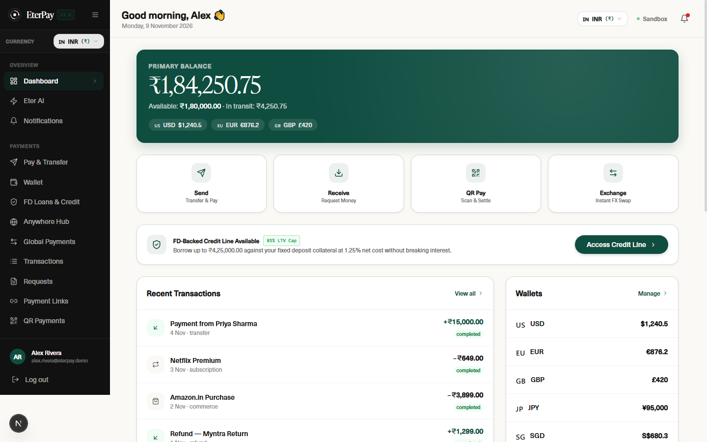
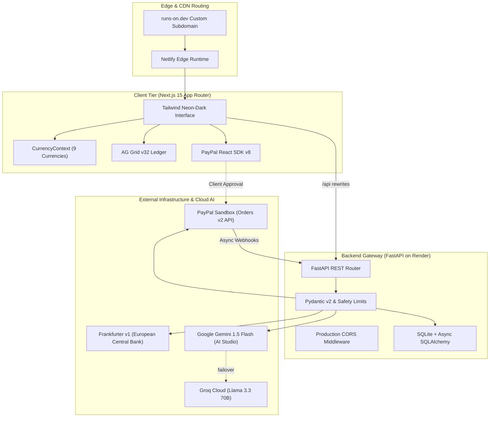

<div align="center">

  <h1>
    
    ETERPAY
  </h1>

  <p><strong><em>Beyond Borders. Beyond Payments.</em></strong></p>

  <p><strong>An AI-powered global financial platform concept exploring smarter cross-border payments, currency intelligence, and institutional-grade ledger transparency.</strong></p>

---

[](https://eterpay.runs-on.dev)
[](https://eterpay.onrender.com/docs)
[](https://github.com/jashveer-sharma/eterpay/actions)
[](LICENSE)

<br/>

[](https://nextjs.org/)
[](https://react.dev/)
[](https://www.typescriptlang.org/)
[](https://tailwindcss.com/)
[](https://www.ag-grid.com/)
[](https://fastapi.tiangolo.com/)
[](https://python.org/)
[](https://developer.paypal.com/)
[](https://ai.google.dev/)
[](https://groq.com/)
[](https://api.frankfurter.app/)

<br/>

<p align="center">
  
</p>

</div>

---

## Table of Contents

- [1. Executive Summary](#1-executive-summary)
- [2. Problem, Solution & Value](#2-problem-solution--value)
- [3. PayPal + AI Hackathon Integration](#3-paypal--ai-hackathon-integration)
- [4. Visual Showcase](#4-visual-showcase)
- [5. Implemented Features & Core Capabilities](#5-implemented-features--core-capabilities)
- [6. Technical Architecture](#6-technical-architecture)
- [7. Technology Stack](#7-technology-stack)
- [8. Installation & Local Development](#8-installation--local-development)
- [9. Financial Safety & Security Boundaries](#9-financial-safety--security-boundaries)
- [10. Project Roadmap](#10-project-roadmap)
- [11. Contributors & Acknowledgements](#11-contributors--acknowledgements)

---

## 1. Executive Summary

**EterPay** is an enterprise-grade fintech prototype engineered for cross-border payments, dynamic multi-currency treasury management, and intelligent financial operations. 

Developed specifically for the **PayPal + AI Global Hackathon**, EterPay establishes a **Deterministic Payment Gate**: a zero-trust boundary where conversational AI models (Google Gemini 1.5 Flash and Groq Llama 3.3 70B) analyze transactions, detect subscription leaks, and propose optimized cross-border payment parameters—while reserving **100% of fund movement authorization for human approval inside PayPal's secure modal environment**.

---

## 2. Problem, Solution & Value

```
┌─────────────────────────────────┐       ┌──────────────────────────────────┐       ┌──────────────────────────────────┐
│             PROBLEM             │       │             SOLUTION             │       │              VALUE               │
│ • Hidden FX markups (3–7%)      │ ────► │ • Real-time ECB interbank feeds  │ ────► │ • Transparent exchange rates     │
│ • Disconnected payment rails    │       │ • Unified PayPal Orders v2 gate  │       │ • Single checkout experience     │
│ • Uncontrolled subscription run │       │ • AI autonomous spend audits     │       │ • Zero recurring capital leakage │
│ • Illiquid long-term deposits   │       │ • ReserveLien™ FD-backed credit  │       │ • Liquidity without yield loss   │
└─────────────────────────────────┘       └──────────────────────────────────┘       └──────────────────────────────────┘
```

### The Problem
Traditional international commerce suffers from predatory Dynamic Currency Conversion (DCC), where payment processors and foreign card terminals introduce synthetic 3% to 7% exchange spreads without transparent disclosure. At the same time, consumers and remote businesses lose money each month on zombie software subscriptions, fragmented multi-currency balances, and rigid banking products that force users to break compound-interest term deposits whenever short-term liquidity is needed.

### The EterPay Approach
1. **Direct Interbank Currency Transparency:** EterPay pulls live benchmark foreign exchange rates directly from the European Central Bank (via Frankfurter API v1) with zero hidden markups.
2. **Context-Aware AI Intelligence:** The platform features **Eter AI**, an autonomous financial copilot that conducts real-time subscription audits, plans cross-border travel budgets, compares remittance rails, and filters complex transaction ledgers through natural conversation.
3. **Institutional-Grade Auditability:** Every balance change, payment intent, and settlement is recorded in an immutable ledger presented via **AG Grid Community v32** with microsecond filtering and instant CSV compliance export.
4. **ReserveLien™ Capital Preservation:** An innovative fixed-deposit collateral engine that calculates net-spread credit lines (e.g., borrowing at 8.45% against a 7.20% earned yield for an effective borrowing cost of just 1.25% p.a.), protected by an 85% Loan-to-Value (LTV) ceiling.

---

## 3. PayPal + AI Hackathon Integration

EterPay's core architectural contribution is reconciling generative AI with the non-negotiable security requirements of production financial infrastructure.

```
                  ┌────────────────────────────────────────────────────────┐
                  │                 CONVERSATIONAL AI TIER                 │
                  │        (Google Gemini 1.5 Flash / Groq Llama 3.3)      │
                  └───────────────────────────┬────────────────────────────┘
                                              │ Proposes Intent (Tool Call)
                                              ▼
                  ┌────────────────────────────────────────────────────────┐
                  │                FASTAPI BACKEND GATEWAY                 │
                  │      Pydantic v2 Validation & Financial Limit Check    │
                  └───────────────────────────┬────────────────────────────┘
                                              │ Creates Order (Idempotent UUID v4)
                                              ▼
                  ┌────────────────────────────────────────────────────────┐
                  │                 PAYPAL ORDERS v2 API                   │
                  │                 https://api-m.sandbox.paypal.com       │
                  └───────────────────────────┬────────────────────────────┘
                                              │ Returns Approve Link
                                              ▼
                  ┌────────────────────────────────────────────────────────┐
                  │                  EXPLICIT USER APPROVAL                │
                  │             PayPal JavaScript SDK Modal (v6)           │
                  └───────────────────────────┬────────────────────────────┘
                                              │ Human Click: "Pay Now"
                                              ▼
                  ┌────────────────────────────────────────────────────────┐
                  │             CAPTURE & WEBHOOK VERIFICATION             │
                  │    HMAC-SHA256 Signature Checked ──► Ledger Committed  │
                  └────────────────────────────────────────────────────────┘
```

### How PayPal is Integrated
* **PayPal Orders v2 API:** Server-side order creation (`POST /v2/checkout/orders`) supporting multi-currency calculations with automatic fallback from local currencies (e.g. INR) to USD based on live ECB rates.
* **Client Modal Approval:** Rendered via `@paypal/react-paypal-js` in a modal dialog, isolating payment credentials outside the host application's DOM.
* **Server-Side Order Capture:** Direct server-to-server execution (`POST /v2/checkout/orders/{id}/capture`) with comprehensive status verification (`COMPLETED`).
* **Asynchronous Webhook Listener:** Listens for `CHECKOUT.ORDER.APPROVED` and `PAYMENT.CAPTURE.COMPLETED` events, validating PayPal transmission headers (`PAYPAL-TRANSMISSION-ID`, `PAYPAL-CERT-URL`, `PAYPAL-AUTH-ALGO`) before committing records to the database.

### The Role of Artificial Intelligence
* **Deterministic Payment Gate:** The AI model has **zero authority** to directly initiate money transfers or modify account balances. It is strictly limited to generating structured payment proposals.
* **Tool Calling & Schema Enforcement:** Uses strict JSON schema enforcement to execute 8 distinct financial tools:
  1. `convert_currency`: Zero-spread live interbank exchange calculation.
  2. `travel_budget_plan`: Destination-specific budget modeling across 4 global corridors.
  3. `search_commerce`: Catalog discovery across cross-border merchants.
  4. `filter_transactions_grid`: Natural language bridge to AG Grid column filters.
  5. `propose_payment`: Strict schema proposal for user-confirmed checkout.
  6. `get_balance_breakdown`: Aggregated treasury balance summaries.
  7. `get_spending_digest`: Category-by-category expense decomposition.
  8. `audit_subscriptions`: Identification of unused or recurring subscription leaks.
* **Zero-Cost Multi-Tier Failover:** Primary reasoning routes through **Google Gemini 1.5 Flash**, falls back to **Groq Llama 3.3 70B** on rate limits, and safely degrades to a local deterministic regex/rule engine if both AI endpoints are unavailable.

---

## 4. Visual Showcase

<div align="center">

<table width="100%">
  <tr>
    <th width="50%" align="center">Executive Dashboard & FX Matrix</th>
    <th width="50%" align="center">AG Grid High-Performance Audit Ledger</th>
  </tr>
  <tr>
    <td width="50%" align="center" valign="top">
      
      <p align="center"><em>Real-time multi-currency balances across 9 global reserve currencies with 1-click active currency switching.</em></p>
    </td>
    <td width="50%" align="center" valign="top">
      
      <p align="center"><em>Enterprise ledger featuring uniform status dots, subtle category tags, dynamic AI filtering, and instant CSV export.</em></p>
    </td>
  </tr>
  <tr>
    <th width="50%" align="center">Eter AI Context-Aware Financial Copilot</th>
    <th width="50%" align="center">ReserveLien™ FD-Backed Credit Portal</th>
  </tr>
  <tr>
    <td width="50%" align="center" valign="top">
      
      <p align="center"><em>Subscription leak auditor, travel budget builder, and remittance fee comparison engine.</em></p>
    </td>
    <td width="50%" align="center" valign="top">
      
      <p align="center"><em>Capital preservation engine calculating effective net borrowing costs (1.25% p.a.) backed by fixed deposits.</em></p>
    </td>
  </tr>
  <tr>
    <th width="50%" align="center">European Central Bank FX Matrix (Frankfurter v1)</th>
    <th width="50%" align="center">Universal Payment & Commerce Terminal</th>
  </tr>
  <tr>
    <td width="50%" align="center" valign="top">
      
      <p align="center"><em>Live interbank reference quotes, historical volatility calculations, and custom rate alert triggers.</em></p>
    </td>
    <td width="50%" align="center" valign="top">
      
      <p align="center"><em>Integrated PayPal Orders v2 sandbox checkout with dual-layer safety barriers.</em></p>
    </td>
  </tr>
</table>

</div>

---

## 5. Implemented Features & Core Capabilities

| Feature Module | Route | Implementation Status | Technical Highlights |
|---|:---:|:---:|---|
| **Executive Dashboard** | `/dashboard` | `✓ Fully Working` | Multi-currency summary across 9 global reserve currencies (INR, USD, EUR, GBP, JPY, SGD, AED, CAD, AUD) with real-time conversion. |
| **AG Grid Audit Ledger** | `/transactions` | `✓ Fully Working` | `@ag-grid-community/core` v32 with client-side sorting, pagination, column filtering, search, CSV export, and AI filtering bridge. |
| **Eter AI Copilot** | `/ai` | `✓ Fully Working` | Multi-tier AI routing (Gemini 1.5 &rarr; Groq Llama 3.3 &rarr; Rule Engine) with 8 verified tool functions and interactive action cards. |
| **Live ECB Currency Rates** | `/currency` | `✓ Fully Working` | Zero-spread conversion feed via Frankfurter API v1, 30-day volatility metrics, and persistent user rate alert triggers. |
| **PayPal Sandbox Checkout** | `/pay` | `✓ Fully Working` | End-to-end PayPal Orders v2 creation, client modal approval (`@paypal/react-paypal-js`), capture, and database settlement. |
| **ReserveLien™ FD Credit** | `/loans` | `✓ Fully Working` | Compound interest mathematical engine, strict 85% LTV cap enforcement, and 2FA PIN security gate. |
| **Cross-Border Commerce** | `/commerce` | `✓ Fully Working` | Multi-currency catalog with instant PayPal checkout and real-time converted pricing. |
| **Travel & Anywhere Hub** | `/travel` | `✓ Fully Working` | Corridor budget estimator and simulated foreign rail checkout (UPI, PayNow, PromptPay). |
| **Digital Invoicing & Links** | `/invoices`, `/links` | `✓ Fully Working` | Interactive invoice builder, printable PDF-ready layouts, and shareable payment link generator. |
| **Portfolio Stress Tester** | `/invest` | `⚑ Simulated` | Educational scenario simulation with mandatory permanent UI badge: `[Simulated Portfolio — Educational Only]`. |

---

## 6. Technical Architecture

### Complete System Workflow



---

## 7. Technology Stack

### Frontend Architecture
* **Framework:** Next.js 15.5.29 (React 19, App Router architecture)
* **Language:** TypeScript 5.6
* **Styling:** Tailwind CSS 3.4 (`clsx`, `tailwind-merge`)
* **Data Grid:** AG Grid Community v32.3 (`@ag-grid-community/client-side-row-model`, `@ag-grid-community/csv-export`)
* **Payment SDK:** `@paypal/react-paypal-js` v8.8
* **Icons:** Lucide React v0.460

### Backend & AI Infrastructure
* **Web Framework:** FastAPI 0.115 (Python 3.11+)
* **Data Validation:** Pydantic v2
* **Database & ORM:** SQLite with `aiosqlite` and SQLAlchemy Async
* **HTTP Client:** HTTPX 0.28 (async non-blocking connections)
* **Primary AI Engine:** Google Gemini 1.5 Flash (`google-generativeai`)
* **Fallback AI Engine:** Groq Cloud Llama 3.3 70B Versatile (`groq`)
* **Market Data Provider:** Frankfurter API v1 (Zero-key European Central Bank daily reference feeds)
* **Testing:** Pytest 9.2 with `pytest-asyncio` (35 automated tests passing)

### Production Hosting & Deployment
* **Domain Registry:** `runs-on.dev` (Advance Labs) &rarr; `https://eterpay.runs-on.dev`
* **Frontend Hosting:** Netlify (Next.js Runtime v5) &rarr; `https://eterpay.netlify.app`
* **Backend Hosting:** Render Web Service (Oregon, US) &rarr; `https://eterpay.onrender.com`

---

## 8. Installation & Local Development

### 1. Prerequisites
* **Node.js** v20.x or higher
* **Python** v3.11 or higher
* **Git**

### 2. Repository Cloning
```bash
git clone https://github.com/jashveer-sharma/eterpay.git
cd eterpay
```

### 3. Backend Setup
```bash
# Navigate to backend directory
cd backend

# Create and activate virtual environment
python -m venv .venv

# Windows
.\.venv\Scripts\activate
# macOS/Linux: source .venv/bin/activate

# Install dependencies
pip install -r requirements.txt

# Create local environment file
cp .env.example .env
```

#### Sample `backend/.env`
```ini
PROJECT_NAME=EterPay
ENVIRONMENT=development

# PayPal Sandbox Credentials (from developer.paypal.com)
PAYPAL_ENVIRONMENT=sandbox
PAYPAL_CLIENT_ID=your_paypal_sandbox_client_id_here
PAYPAL_CLIENT_SECRET=your_paypal_sandbox_client_secret_here
PAYPAL_WEBHOOK_ID=your_optional_webhook_id_here

# AI Engine API Keys
GEMINI_API_KEY=your_google_ai_studio_gemini_key_here
GROQ_API_KEY=your_groq_cloud_api_key_here

# Security Limits
MAX_SINGLE_ORDER_INR=25000.00
MAX_SINGLE_ORDER_USD=300.00

# Database & Authentication
DATABASE_URL=sqlite+aiosqlite:///./eterpay.db
JWT_SECRET=your_super_secret_jwt_key_for_local_development
JWT_ALGORITHM=HS256

# Market Rates Provider
FRANKFURTER_BASE_URL=https://api.frankfurter.app
```

```bash
# Run FastAPI local development server
uvicorn app.main:app --reload --port 8000
```
*API will run at `http://localhost:8000`. Interactive Swagger UI available at `http://localhost:8000/docs`.*

### 4. Frontend Setup
Open a new terminal:
```bash
# Navigate to frontend directory
cd frontend

# Install dependencies
npm install

# Create local environment file
cp .env.example .env.local
```

#### Sample `frontend/.env.local`
```ini
NEXT_PUBLIC_PAYPAL_CLIENT_ID=your_paypal_sandbox_client_id_here
NEXT_PUBLIC_API_URL=http://localhost:8000
NEXT_PUBLIC_BACKEND_URL=http://localhost:8000
```

```bash
# Start Next.js development server
npm run dev
```
*Web client will run at `http://localhost:3000`.*

### 5. Automated Verification Suites
```bash
# Run complete backend test suite (35 tests passing)
cd backend
pytest tests/ -v

# Run production frontend build verification (42 routes static export)
cd frontend
npm run build
```

---

## 9. Financial Safety & Security Boundaries

* **Zero Committed Secrets:** All production credentials, PayPal secrets, and LLM API keys are managed exclusively via environment variables and excluded via `.gitignore`.
* **Idempotency Enforcement:** Every PayPal payment creation request automatically attaches a unique UUID v4 `PayPal-Request-Id` header, eliminating the risk of accidental double-charges during client retry loops.
* **Deterministic Payment Gate:** Generative language models operate solely as financial advisors and schema proposers. The model cannot execute debit transactions or bypass the human confirmation step inside PayPal's secure modal.
* **PCI-DSS Scope Reduction:** No credit card numbers, CVVs, or cardholder credentials ever touch or traverse EterPay servers; all card data collection occurs within PayPal's hosted iframes.
* **Spend Barrier Safeguards:** The backend enforces hard per-transaction transaction spending limits (`MAX_SINGLE_ORDER_INR` = ₹25,000; `MAX_SINGLE_ORDER_USD` = $300) to protect test accounts against abnormal volume.
* **Simulation Badges:** Educational investment stress tests render an unremovable safety badge: `[Simulated Portfolio — Educational Only — No Capital at Risk]`.

---

## 10. Project Roadmap

### Phase 1: Core Foundation & Ledger (`Completed`)
- [x] Complete Next.js 15 App Router frontend with responsive neon-dark styling.
- [x] High-performance AG Grid transaction ledger with CSV export and uniform status indicators.
- [x] Live European Central Bank foreign exchange integration via Frankfurter API v1.
- [x] PayPal Orders v2 sandbox checkout integration with client-side modal approval.
- [x] Multi-currency context supporting INR, USD, EUR, GBP, JPY, SGD, AED, CAD, and AUD.

### Phase 2: AI Orchestration & Financial Tools (`Completed`)
- [x] Context-aware Eter AI copilot supporting 8 financial tools via JSON schema.
- [x] Dual-model routing: Google Gemini 1.5 Flash primary with Groq Llama 3.3 70B fallback.
- [x] ReserveLien™ Fixed Deposit-backed loan math engine with 85% LTV ceiling and 2FA gate.
- [x] Natural language AG Grid column filtering via conversational AI commands.
- [x] Dual-cloud deployment: Netlify (Frontend) + Render (Backend) on `eterpay.runs-on.dev`.

### Phase 3: Production Expansion (`Planned`)
- [ ] PayPal Vault integration for automated recurring subscription cancellations.
- [ ] Real-time WebSocket feed for sub-second interbank rate updates.
- [ ] Multi-party split settlement for international freelance milestone contracts.
- [ ] Biometric WebAuthn passkey authentication for high-value cross-border approvals.

---

## 11. Contributors & Acknowledgements

### Project Creator
* **Jashveer Sharma** ([@jashveer-sharma](https://github.com/jashveer-sharma)) — Full-Stack Fintech Architect & AI Engineer.

### Built For
* **PayPal + AI Global Hackathon** — Demonstrating how next-generation AI reasoning can be safely integrated with PayPal's global payment rails.

### Acknowledgements
* [PayPal Developer Platform](https://developer.paypal.com/) — For Orders v2 REST APIs and JavaScript SDK.
* [Google AI Studio](https://ai.google.dev/) — For Gemini 1.5 Flash high-throughput tool-calling APIs.
* [Groq Cloud](https://groq.com/) — For ultra-low latency Llama 3.3 70B inference.
* [European Central Bank](https://www.ecb.europa.eu/) & [Frankfurter API](https://api.frankfurter.app/) — For reliable, zero-spread foreign exchange reference data.
* [AG Grid](https://www.ag-grid.com/) — For the institutional-grade client-side financial data grid.

---

<div align="center">
  <sub>Built with precision for global financial inclusion. © 2026 EterPay. Licensed under the <a href="LICENSE">MIT License</a>.</sub>
</div>
