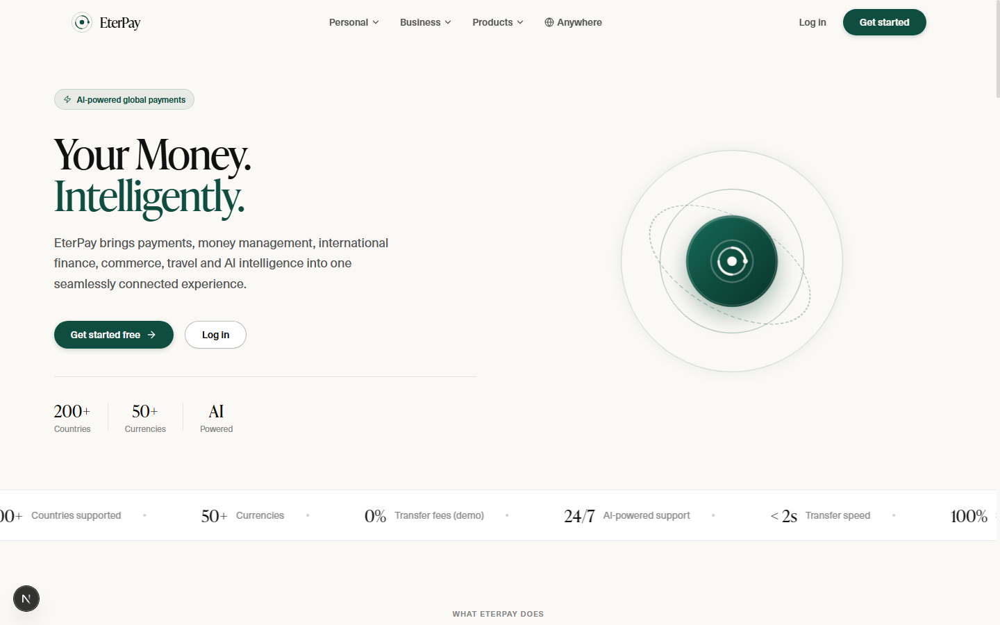
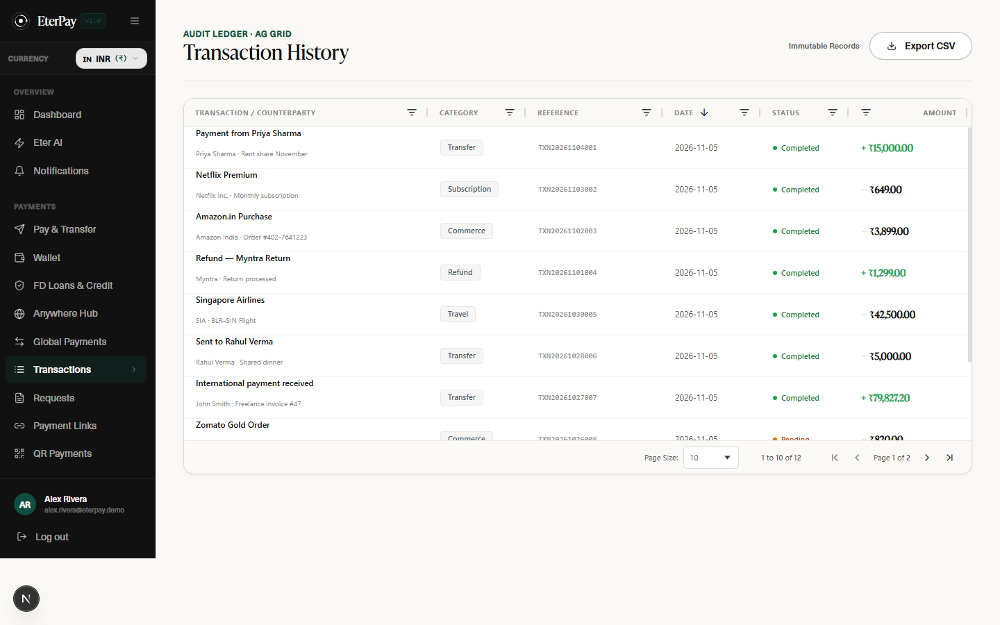
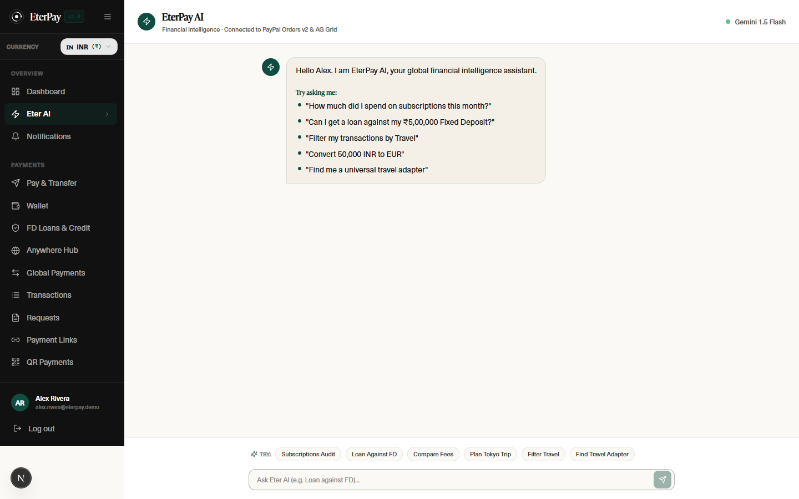
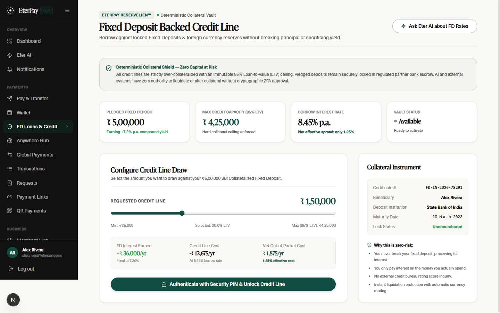
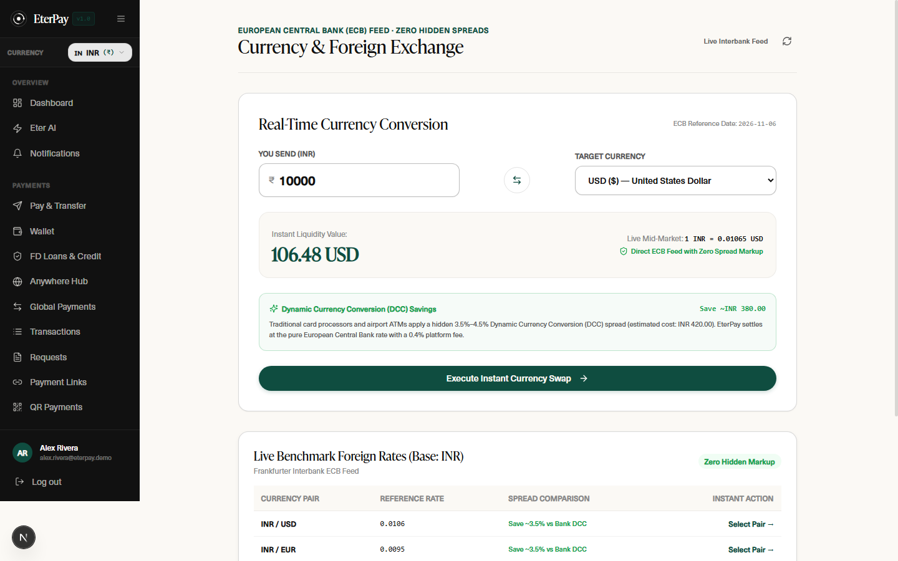

# EterPay — AI-Powered Global Financial Platform

<div align="center">

<p align="center">
  
</p>

**Your Money. Everywhere. Intelligently Connected.**

[](https://nextjs.org/)
[](https://fastapi.tiangolo.com/)
[](https://developer.paypal.com/)
[](https://www.ag-grid.com/)
[](https://ai.google.dev/)
[](https://groq.com/)
[](https://api.frankfurter.dev/v1)
[](https://eterpay.runs-on.dev)

</div>

---

## Executive Overview

**EterPay** is an enterprise-grade fintech platform engineered for seamless cross-border commerce, multi-currency treasury management, and intelligent automated financial operations. Built upon strict PCI-DSS boundaries, EterPay merges **PayPal Orders v2** execution with **multi-tier AI orchestration** and **AG Grid high-throughput audit ledgers**.

---

## Key Platform Innovations

### 1. Unified Dashboard & 1-Click Multi-Currency Switcher
Monitor multi-currency balances across 9 global reserve currencies (INR, USD, EUR, GBP, JPY, SGD, AED, CAD, AUD). Powered by live European Central Bank (ECB) reference rates synced via the Frankfurter v1 interbank engine.

<p align="center">
  
</p>

* **Deterministic Payment Gate:** AI never moves funds directly. Intent Proposal &rarr; Pydantic Validation &rarr; Explicit User "Approve" Modal &rarr; PayPal Orders API &rarr; Webhook Signature Verification.
* **Idempotency Guarantee:** Every payment creation attaches a unique UUID v4 `PayPal-Request-Id` to guarantee zero double-charges during retries.

---

### 2. AG Grid High-Performance Audit Ledger
Institutional-grade transaction ledger utilizing `@ag-grid-community/core` and `@ag-grid-community/client-side-row-model` v32.

<p align="center">
  
</p>

* **Standardized Status Indicators:** Clean, high-trust status indicator dots (`• Completed`, `• Pending`, `• Failed`).
* **Uniform Category Badges:** Subtle, consistent badge geometry preventing visual distortion across variable string lengths.
* **Dynamic AI Grid Filtering:** Conversational requests in Eter AI (*"Filter transactions by Travel"*) dynamically apply column filters via the client-side grid bridge.
* **Instant CSV Export:** One-click compliance and accounting ledger download.

---

### 3. Eter AI — Context-Aware Financial Copilot
A multi-tier zero-cost conversational intelligence engine routed across **Google Gemini 1.5 Flash**, **Groq Llama 3.3 70B**, and a **deterministic autonomous NLP fallback**.

<p align="center">
  
</p>

* **Subscription Audits:** Analyzes recurring expenditures and recommends pausing dormant services (e.g. Figma unused for 18 days &rarr; save ₹1,200/mo).
* **Cross-Border Budgeting:** Real-time destination budget planning (Tokyo, Paris, Dubai, London) converted at zero-spread interbank ECB rates.
* **Fee Comparison Engine:** Mathematical head-to-head analysis between PayPal Sandbox, Wise, and Airtm rails.

---

### 4. ReserveLien™ — Fixed Deposit-Backed Liquidity Shield
Access liquidity without breaking long-term term deposits or forfeiting accrued compounding yield.

<p align="center">
  
</p>

* **Collateral Mathematics:** Pledges ₹5,00,000 SBI Fixed Deposit (+7.20% earned yield) against an 8.45% borrow rate for an effective net borrowing cost of only **1.25% p.a.**
* **Hard 85% LTV Cap:** Strict safety barrier preventing margin calls or under-collateralization.
* **2FA Security PIN Gate:** Every credit drawdown requires an encrypted 4-digit biometric/PIN authorization.

---

### 5. Live ECB Interbank Rates (Frankfurter v1)
Zero-key, zero-cost European Central Bank exchange feed delivering live reference quotes with zero synthetic markup.

<p align="center">
  
</p>

---

## Architectural Workflow

```
[ User Interaction ] ──> [ Next.js 15 App Router ] ──> [ 1-Click Currency Context ]
                                   │
                 ┌─────────────────┴─────────────────┐
                 ▼                                   ▼
        [ FastAPI Backend ]                 [ Eter AI Orchestration ]
                 │                                   │
       ┌─────────┴─────────┐               ┌─────────┴─────────┐
       ▼                   ▼               ▼                   ▼
 [ PayPal Orders v2 ]  [ SQLite Ledger ] [ Gemini 1.5 ]    [ Groq Llama 3.3 ]
  (Modal Approval &      (Immutable Audit (Tool Calling &     (Zero-Cost
   Webhook Verif)         Ledger Storage)  FX Reasoning)       Fallback)
```

---

## Technology Stack

| Layer | Technologies | Purpose |
|---|---|---|
| **Frontend** | Next.js 15.5, React 19, TypeScript, Tailwind CSS | High-performance responsive application |
| **Data Grid** | AG Grid Community v32.3 (`client-side-row-model`, `csv-export`) | Institutional transaction ledger |
| **Payments** | `@paypal/react-paypal-js`, PayPal Orders v2 REST API | Sandbox checkout, capture, webhooks |
| **Backend** | Python 3.11+, FastAPI, Pydantic v2, SQLAlchemy Async | Scalable async REST API & payment gate |
| **Database** | SQLite + aiosqlite | Persistent audit ledger & rate alerts |
| **AI Engine** | Gemini 1.5 Flash (Google AI Studio) + Groq (Llama 3.3 70B) | Contextual fintech intelligence |
| **Market Rates** | Frankfurter API v1 (ECB Reference Feeds) | Free live foreign exchange rates |

---

## Security & Compliance Architecture

* **Zero Committed Secrets:** All PayPal Client Secrets, Gemini/Groq keys, and database credentials are fully externalized via `.env`.
* **Deterministic Payment Gate:** The AI model is strictly restricted to proposing payment parameters. No transaction can execute without direct human interaction inside the PayPal modal.
* **Webhook Signature Verification:** Webhook endpoints validate `PAYPAL-TRANSMISSION-ID`, `PAYPAL-CERT-URL`, and transmission signatures before ledger commitment.
* **Anti-DCC Shield:** Alerts users against Dynamic Currency Conversion spreads at foreign point-of-sale terminals.

---

## Quickstart Guide

### 1. Prerequisites
* **Node.js** v20+ & `npm`
* **Python** v3.11+ & `pip`
* **Git**

### 2. Backend Setup
```bash
cd backend
python -m venv .venv
.\.venv\Scripts\activate      # Windows (or: source .venv/bin/activate on Linux/macOS)
pip install -r requirements.txt
uvicorn app.main:app --reload --port 8000
```
Backend runs at `http://127.0.0.1:8000` (API documentation at `/docs`).

### 3. Frontend Setup
```bash
cd frontend
npm install
npm run dev
```
Open `http://localhost:3000` in your browser.

---

## Verification & Test Suite

Verify all components locally:

```bash
# Backend test suite (10/10 tests passing)
cd backend
.\.venv\Scripts\pytest tests/ -v

# Production build verification (0 errors, 42 routes static export)
cd frontend
npm run build
```

---

## License

This project is licensed under the MIT License — see the [LICENSE](LICENSE) file for details.
