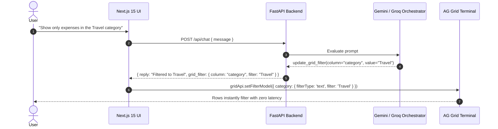

# System Interaction Flows (Phase 10)

> **Document Status:** System Interaction & Sequence Specifications  
> **Visual Format:** Mermaid Sequence Diagrams

---

## 1. End-to-End Safe PayPal Checkout Flow

```mermaid
sequenceDiagram
    autonumber
    actor User
    participant Frontend as Next.js 15 UI
    participant Backend as FastAPI Backend
    participant AI as Gemini 1.5 Flash
    participant PayPal as PayPal Sandbox API
    participant DB as SQLite / Postgres

    User->>Frontend: "Buy the Anker travel adapter for ₹1,499"
    Frontend->>Backend: POST /api/chat { message }
    Backend->>AI: Parse intent & query tools
    AI-->>Backend: prepare_payment_order(17.80, "USD", "Anker Direct")
    Backend->>Backend: Safety validation (< $300 limit check)
    Backend-->>Frontend: ActionProposal { title, amount: 17.80, currency: "USD" }
    
    Note over Frontend,User: Deterministic Human Approval Gate
    Frontend->>User: Renders high-contrast Action Card
    User->>Frontend: Clicks "Approve with PayPal"
    
    Frontend->>Backend: POST /api/paypal/create-order { amount: 17.80, currency: "USD" }
    Backend->>PayPal: POST /v2/checkout/orders (with PayPal-Request-Id)
    PayPal-->>Backend: { order_id: "8AB12345CD67" }
    Backend-->>Frontend: { order_id: "8AB12345CD67" }
    
    Frontend->>PayPal: Renders PayPal JS SDK Modal
    User->>PayPal: Logs into Sandbox Buyer & Authorizes
    PayPal-->>Frontend: onApprove(data)
    
    Frontend->>Backend: POST /api/paypal/capture-order { order_id }
    Backend->>PayPal: POST /v2/checkout/orders/8AB12345CD67/capture
    PayPal-->>Backend: { status: "COMPLETED", capture_id: "CAP-987" }
    Backend->>DB: INSERT INTO transactions (status: "COMPLETED")
    Backend-->>Frontend: { status: "COMPLETED" }
    Frontend->>User: Appends to AG Grid Ledger; updates remaining budget
```

---

## 2. Dynamic AG Studio Grid Filter Flow


